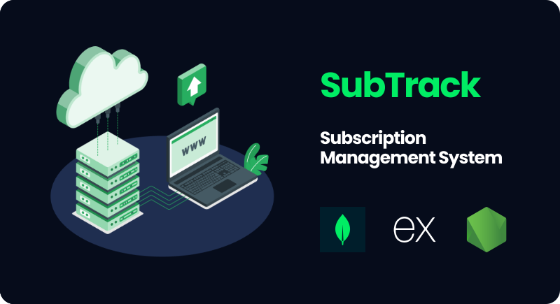

<p align="center">
  
</p>

##

<p align="center">
  
  
  
  
  
</p>

<h1 align="center">SubTrack</h1>

<p align="center">
  Track every subscription, renewal date and monthly cost in one place.<br/>
  An Express + MongoDB API with JWT auth, rate limiting and automated email reminders, plus a React dashboard.
</p>

---

## ✨ Features

- 📊 **Dashboard** – Monthly and yearly spend, upcoming renewals and a filterable subscription list
- 🔐 **JWT Authentication** – Sign up, sign in, and self-service account updates and deletion
- 🧾 **Subscription Management** – Create, edit, cancel and delete, with next renewal dates calculated automatically
- 🛡 **Rate Limiting & Bot Protection** – Arcjet shield, bot detection and token-bucket rate limiting
- 📧 **Email Reminders** – Upstash Workflow sends reminders 7, 5, 2 and 1 days before each renewal
- ⚡ **Centralized Error Handling** – Consistent JSON errors with proper status codes

---

## 🗂 Project Structure

```
api/       Vercel function entry (wraps the Express app)
client/    React 19 + TypeScript + Vite + Tailwind CSS dashboard
server/    Express API: routes, controllers, Mongoose models, workflows
```

On Vercel both ship as one project: the dashboard is served statically and `/api/*` runs the Express app as a serverless function.

---

## ⚡ Quick Start

```bash
git clone https://github.com/Renz-Eryll/SubTrack.git
cd SubTrack
npm install                                              # installs server + client (npm workspaces)
cp server/.env.example server/.env.development.local     # then fill in your keys
npm run dev                                              # API on :5500, dashboard on :5173
```

| Script | What it does |
| --- | --- |
| `npm run dev` | Runs the API and the dashboard together |
| `npm run build` | Type-checks and builds the dashboard |
| `npm run lint` | Lints server and client |

---

## 🔌 API

All routes are under `/api/v1`. Protected routes need `Authorization: Bearer <token>`.

| Method | Route | Auth | Description |
| --- | --- | --- | --- |
| POST | `/auth/sign-up` | | Create an account, returns a token |
| POST | `/auth/sign-in` | | Sign in, returns a token |
| POST | `/auth/sign-out` | | Client discards its token |
| GET / PUT / DELETE | `/users/:id` | ✓ | Read, update or delete your own account |
| GET | `/subscriptions` | ✓ | Your subscriptions |
| POST | `/subscriptions` | ✓ | Create one and schedule reminders |
| GET | `/subscriptions/upcoming-renewals?days=7` | ✓ | Active subscriptions renewing soon |
| GET / PUT / DELETE | `/subscriptions/:id` | ✓ | Read, update or delete one of yours |
| PUT | `/subscriptions/:id/cancel` | ✓ | Mark as cancelled (stops reminders) |
| GET | `/health` | | Health check |

---

## 📧 Contact

- **Name**: Renz Eryll Ramelo  
- **LinkedIn**: [linkedin.com/in/renz-eryll-ramelo](https://www.linkedin.com/in/renz-eryll-ramelo)  
- **GitHub**: [github.com/Renz-Eryll](https://github.com/Renz-Eryll)  
